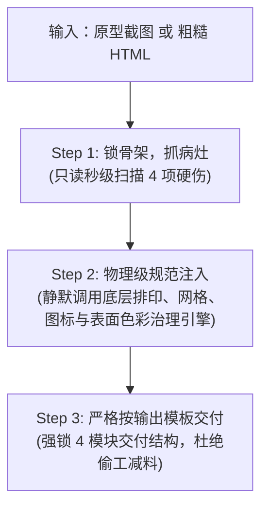

# ui-refiner (增量原型工业化规整机)

专为设计师接手 PM 拼装的增量粗糙原型而设计的全自动重构主控。
**核心原则**：不讨论抽象设计哲学，不动核心业务骨架，纯靠人因工程学常数对代码进行物理级纠偏。

---

## 一、 输入定性与承重墙锁定

接收到输入后，立即进行**业务实体绝对锁定**：

1. **输入源识别**：
   * **输入 A：原型截图（图片）**：通过视觉识别提取页面拓扑（导航、表单、表格、操作按钮）；
   * **输入 B：存量 HTML（代码）**：解析现有 DOM 树结构。
2. **绝对承重墙锁定（Entity Freeze）**：
   * 原型中的全部数据字段、输入框标签、表格列头、主副按钮**严禁删除或合并**；
   * 业务动线与交互事件保持原样。

---

## 二、 三步直通作业 SOP



### Step 1：锁骨架，抓病灶（Lock & Scan）
* **定位**：只读扫描。向设计师列出页面客观存在的 4 项机械硬伤清单：
  1. **图标乱象**：统计非标图标数量（emoji 占位、外挂 PNG 位图、尺寸逃逸、线宽不一）；
  2. **排印压迫**：定位单行字数超过 45 汉字（>75字符）的拉伸容器、行高 $< 1.35$ 的密集文本，以及手写的半像素字号（如 11.5px/13.5px）；
  3. **网格逃逸**：定位未整除 4px 的非标间距（如 3px, 5px, 7px, 9px, 10px, 14px）；
  4. **表面粗糙**：定位 APCA 文本层级未拉开（$\Delta L_c < 15$）、辅助说明跌破生存线（$L_c < 45$），以及相邻容器依赖突兀深浅大色块硬拼（缺少负空间或微边框分离）。

### Step 2：物理级参数校准（Direct Calibration）
* **定位**：代码重构。静默调度后台三大治理引擎，实施确定性补丁：
  1. **排印治理（挂载 `ui-typography-governance`）**：
     * 主阅读视口/正文容器强制追加 `max-width: 65ch; margin-inline: auto;`（约 680px）；
     * 正文行高统一注入 `line-height: 1.6`，段落追加 `margin-block-end: 0.85em`；
     * 清除所有半像素字号，对齐标尺整数阶梯（12px, 13px, 14px, 16px, 20px）；
     * 绝不机械限定字重（杜绝规则膨胀），字重服从业务与宿主环境。
  2. **空间网格（挂载 `ui-layout-surface-governance`）**：
     * 所有 `padding`, `margin`, `gap` 统一吸附至 4px 乘数（4, 8, 12, 16, 24, 32px）；
     * 嵌套卡片执行同心圆角：$$R_{\text{inner}} = \max(R_{\text{outer}} - \text{Padding}, 0)$$（保底赋予 2~4px 软微弧）。
  3. **图标资产（挂载 `ui-icon-design`）**：
     * **全面清除外部位图与字符伪图标**：严禁使用 ``，严禁使用 CSS 滤镜反色；
     * **全量装配纯线内联 SVG**：统一装配 16px 或 20px 的内联 Lucide SVG，强制声明 `stroke="currentColor"`，确保离线自包含且随主题原生变色。
  4. **表面与色彩安全治理（挂载 `ui-layout-surface-governance`）**：
     * **调墨不调纸**：低对比度文字仅通过加深文字墨色（将文本 Token 明度压低）解决，**绝对禁止调暗/调亮大面积容器背景**；
     * **低 Delta 表面阶梯**：浅色模式下相邻静态表面明度差 $\Delta L \le 3\%$，杜绝突兀脏灰泥巴色块；
     * **静态容器边界留白优先**：容器边界优先依赖负空间留白（16~24px）或轻量微边框分离，严禁用深浅色块强行拼接；
     * **交互状态线不可篡改（State Freeze）**：`:focus`, `:focus-visible`, `:active`, 选区及表单校验态的高对比度轮廓线（Focus Ring / Outline）属于无障碍与交互承重墙，**绝对禁止弱化或篡改**（坚守 WCAG 2.4.11 焦点可见性 $\ge 3:1$ 对比度基准）。

### Step 3：交付规整成果（Deliver & Review）
* **交付原则**：必须严格遵循下述【刚性交付输出模板】，严禁只扔一段纯代码而略去元数据审计；
* **环境降级策略**：若宿主环境具备无头浏览器支持，可输出局部切片供肉眼终审；在纯文本或受限沙盒环境中，**截图非强制阻塞项**，跳过截图不影响完整交付。

---

## 三、 刚性交付输出模板（Output Schema Lock）

为杜绝任何 Agent 偷工减料或格式漂移，**所有执行规整任务的 Agent 回复中，必须严格包含以下 4 个结构块**：

````markdown
### 1. 变更对照表（Token & Variable Diff Matrix）
| 维度 | 影响属性 / 选择器 | 原始值 (Raw) | 规整后变量 (Token / Value) | 物理纠偏依据 |
| :--- | :--- | :--- | :--- | :--- |
| **排印** | 正文容器 `max-width` | 无限制 (拉伸全屏) | `var(--measure-body, 65ch)` | 黄金行宽（防眼动疲劳） |
| **排印** | 正文 `line-height` | `1.25` (手写过挤) | `var(--lh-relaxed, 1.6)` | 逆向行高曲线（防墨块粘连） |
| **空间** | 边距 / 间隙 | `7px 15px` (奇数逃逸) | `8px 16px` | 4px 乘数空间标尺吸附 |
| **几何** | 内嵌容器圆角 | `12px` (内外同大变形) | `calc(var(--r-out) - var(--pad))` | 嵌套同心圆角法则 |
| **色彩** | 辅助文本色 | 读不清 / 对比度过低 | 加深 Token 明度 | 调墨不调纸，底色冻结 |
| **表面** | 容器分割方式 | 深浅脏灰大色块硬拼 | 负空间留白 / 微边框分离 | 低 Delta 表面阶梯 |
| **资产** | 控件/导航图标 | `` PNG 位图或字符 | 内联 `<svg>` (16px/20px) | 纯矢量自包含，无碎图风险 |

### 2. APCA 感知阶差核算（Advisory Contrast Audit）
- **Primary (一级焦点/标题)**: 实测 $L_c = \dots$（要求 $\ge 75$）
- **Secondary (二级正文/控件)**: 实测 $L_c = \dots$（要求 $\ge 60$，与一级差值 $\Delta L_c \ge 15$）
- **Tertiary (三级辅助/说明)**: 实测 $L_c = \dots$（要求 $\ge 45$ 绝对底线，与二级差值 $\Delta L_c \ge 15$）

### 3. 交付前反思与自检门禁（Self-Check Verification Gate）
- [x] **图标自包含**：已清除所有外部 ``/PNG 依赖，100% 转换为内联 SVG 并声明 `stroke="currentColor"`。
- [x] **4px 标尺归一**：已清除所有非标/奇数像素（如 3px, 5px, 7px, 9px, 10px, 14px），严格吸附 4px 乘数。
- [x] **整数纯净字阶**：已清除所有浮点半像素字号（如 11.5px, 13.5px），杜绝 ClearType 虚化。
- [x] **黄金视宽限制**：多行正文阅读容器均已注入 `max-width: 65ch`。
- [x] **焦点承重墙保护**：未弱化或破坏任何 `:focus` / `:focus-visible` / 激活态的交互高对比度轮廓线。

### 4. 规整后代码（Production-Grade Code）
```html
<!DOCTYPE html>
...完整可运行代码，自包含纯线内联 SVG，无任何外部资产破链风险...
```
````
