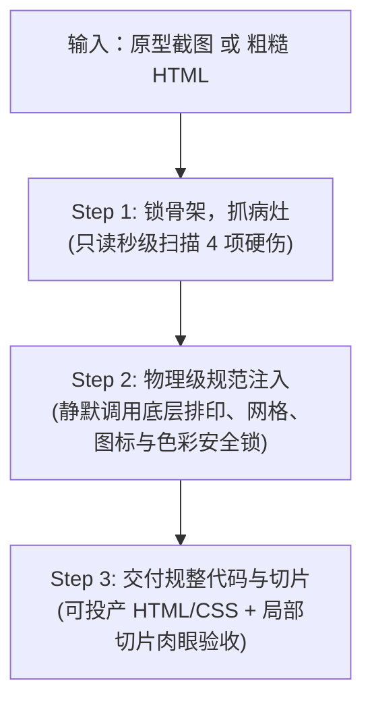

# ui-refiner (增量原型工业化规整机)

专为设计师接手 PM 拼装的增量粗糙原型而设计的全自动重构主控。
**核心原则**：不讨论抽象设计哲学，不动核心业务骨架，纯靠人因工程学常数对代码进行物理级纠偏。

---

## 一、 输入定性与承重墙锁定

接收到输入后，立即进行**业务实体绝对锁定**：

1. **输入源识别**：
   * **输入 A：原型截图（图片）**：通过视觉识别提取页面拓扑（导航、表单、表格、操作按钮）；
   * **输入 B：存量 HTML（代码）**：解析现有 DOM 树结构。
2. **绝对承重墙锁定（Entity Freeze）**：
   * 原型中的全部数据字段、输入框标签、表格列头、主副按钮**严禁删除或合并**；
   * 业务动线与交互事件保持原样。

---

## 二、 三步直通作业 SOP

### Step 1：锁骨架，抓病灶（Lock & Scan）
* **定位**：只读扫描。向设计师列出页面客观存在的 4 项机械硬伤清单：
  1. **图标乱象**：统计非标图标数量（emoji 占位、尺寸逃逸、线宽不一）；
  2. **排印压迫**：定位单行字数超过 45 汉字（>75字符）的拉伸容器、行高 $< 1.35$ 的密集文本，以及手写的半像素字号（如 11.5px/13.5px）；
  3. **网格逃逸**：定位未整除 4px 的非标间距（如 3px, 5px, 7px, 10px, 14px）；
  4. **表面粗糙**：定位 APCA 文本层级未拉开（$\Delta L_c < 15$）、辅助说明跌破生存线（$L_c < 45$），以及生硬粗黑边框。

### Step 2：物理级参数校准（Direct Calibration）
* **定位**：代码重构。静默调度后台三大治理引擎，实施确定性补丁：
  1. **排印治理（挂载 `ui-typography-governance`）**：
     * 主阅读视口/正文容器强制追加 `max-width: 65ch; margin-inline: auto;`（约 680px）；
     * 正文行高统一注入 `line-height: 1.6`，段落追加 `margin-block-end: 0.85em`；
     * 清除所有半像素字号，对齐标尺整数阶梯（12px, 13px, 14px, 16px, 20px）；
     * 绝不机械限定字重（杜绝规则膨胀），字重服从业务与宿主环境。
  2. **空间网格（挂载 `ui-layout-surface-governance`）**：
     * 所有 `padding`, `margin`, `gap` 统一吸附至 4px 乘数（4, 8, 12, 16, 24, 32px）；
     * 嵌套卡片执行同心圆角：$$R_{\text{inner}} = \max(R_{\text{outer}} - \text{Padding}, 0)$$（保底赋予 2~4px 软微弧）。
  3. **图标资产（挂载 `ui-icon-design`）**：
     * 清除 emoji 与字符伪图标；
     * 统一装配全页同构的 16px 或 20px 纯线 Lucide SVG，强制声明 `stroke="currentColor"`。
  4. **色彩安全锁（Color Governance Defense）**：
     * **调墨不调纸**：低对比度文字仅通过加深文字墨色（将文本 Token 明度压低）解决，**绝对禁止调暗/调亮大面积容器背景**；
     * **低 Delta 表面**：浅色模式下相邻表面明度差 $\Delta L \le 3\%$；
     * **发丝线界定**：将粗黑线替换为 `1px solid rgba(0, 0, 0, 0.06 ~ 0.08)` 半透明发丝线。

### Step 3：交付规整代码与切片（Deliver & Review）
* **交付物 1：研发级 HTML/CSS 代码**：
  * DOM 语义清晰，CSS 变量收敛，研发无需二次重构样式即可直接绑定业务数据；
* **交付物 2：局部切片对比**：
  * 通过无头浏览器对规整后的关键区域（高密正文区、操作栏）输出切片比对，设计师花费 3 秒钟肉眼扫一眼整体节奏感，即刻完成闭环验收；
* **交付物 3：变量变更对照表（Token & Variable Diff Matrix）**：
  * 强制显式输出所有被干预的变量明细，杜绝黑盒修改，方便设计师核账与研发对齐；
* **交付物 4：APCA 阶梯感知审计数据（Advisory Evidence · 纯辅助证据）**：
  * 严格遵循“负向排除、不作正向填色模板”原则：出具 Primary $\to$ Secondary $\to$ Tertiary 三级文本阶差 $\Delta L_c$，仅在层级粘连（$\Delta L_c < 15$）或跌破生理底线（$L_c < 45$）时提示，主观色彩氛围 100% 留给设计师肉眼裁决。
  
  | 维度 | 影响属性 / 选择器 | 原始值 (Raw) | 规整后变量 (Token / Value) | 物理纠偏依据 |
  | :--- | :--- | :--- | :--- | :--- |
  | **排印** | 正文容器 `max-width` | 无限制 (拉伸全屏) | `var(--measure-body, 65ch)` | Bringhurst 黄金测度律（防回行眼动疲劳） |
  | **排印** | `.content-body` `line-height` | `1.25` (手写过挤) | `var(--lh-relaxed, 1.6)` | 逆向行高曲线（消除汉字墨块压迫感） |
  | **排印** | `.label-sub` `font-size` | `11.5px` (半像素虚化) | `var(--font-sm, 12px)` | 消除 ClearType 亚像素锯齿 |
  | **空间** | `.card-container` `padding` | `7px 15px` (奇数逃逸) | `var(--space-2, 8px) var(--space-4, 16px)` | 4px 乘数空间标尺吸附 |
  | **几何** | 内嵌容器 `border-radius` | `12px` (内外同大畸变) | `calc(var(--radius-outer) - var(--pad))` (4px) | 嵌套同心圆角法则 |
  | **色彩** | `.text-secondary` `color` | `#999999` (对比度2.3:1) | `var(--text-muted, #555555)` (对比度5.2:1) | WCAG AA 级达标（调墨不调纸，背景冻结） |
  | **感知** | 辅助说明与正文明度 | $\Delta L_c = 4$ (层级粘连) | $\Delta L_c \ge 15$ (梯度清晰) | APCA 阶差模型（保证各级视觉主次） |
  | **资产** | 操作栏图标 | `emoji ⬇️` 或手写字符 | `<svg class="lucide-download" ...>` (16px) | 纯线同构标准矢量库装配 |
